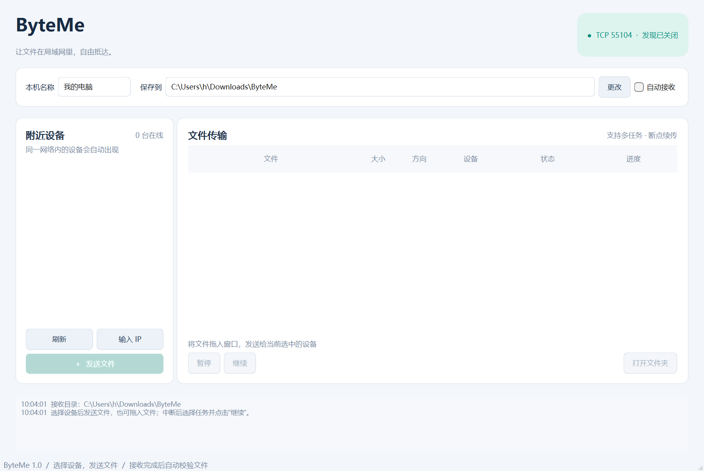

# ByteMe · 局域网文件传输

基于 **Qt 6 / C++17 / MSVC x64** 的桌面文件传输工具，采用 Qt Widgets 界面。设备之间直接传输文件，无需服务器。

## 功能

- `QUdpSocket` 广播发现设备，每 3 秒发送心跳，12 秒未响应时移除设备；支持手动输入 IPv4 地址。
- `QTcpServer` / `QTcpSocket` 可靠文件传输，自定义长度前缀协议处理 TCP 拆包和粘包。
- 每个传输任务使用独立 `QThread`，线程内通过 socket 信号驱动传输；最多 4 个并行发送、8 个同时活动任务，额外发送任务排队。
- 暂停与继续：接收端保存临时文件，重新连接后核验片段 SHA-256 并协商续传位置；损坏片段自动从零重新传输。
- 程序重启后保留未完成发送任务；接收端续传数据保存在磁盘上。
- 文件完整 SHA-256 校验、速度与进度显示、空文件、中文文件名、拖放、多文件发送。
- 接收确认、可选自动接收、接收目录设置、同名文件另存，原文件不会被覆盖。

本工具使用自定义协议，与飞鸽传书的通信协议不互通。当前实现针对 IPv4、单个文件和局域网直连，不含聊天、目录递归、TLS 加密或用户认证。默认单文件上限 1 TiB，实际能力取决于磁盘与文件系统。

## 构建和运行

需要 Visual Studio 2022 的“使用 C++ 的桌面开发”、CMake 3.21+、Qt 6.5+ 的 **MSVC 64 位**套件。

在项目目录打开 PowerShell：

```powershell
.\scripts\build.ps1 -QtRoot "D:\Qt6\6.7.3\msvc2019_64" -Configuration Release -Deploy
.\dist\ByteMe.exe
```

脚本会配置 CMake、使用 MSVC 编译、运行集成测试，并把 Qt DLL、平台插件等运行依赖部署到 `dist/`。把整个 `dist/` 目录复制到另一台 Windows 电脑即可运行；目标电脑还需有兼容的 Microsoft Visual C++ x64 运行库。脚本会尝试从 `QTDIR` 或 PATH 中的 `qmake.exe` 获取 Qt 路径。

部署目录包含 `vc_redist.x64.exe` 时，可在缺少运行库的目标电脑上安装它。

也可以用 Visual Studio 2022 “打开文件夹”打开项目，在 CMake 配置中指定 `CMAKE_PREFIX_PATH` 为 Qt MSVC 套件目录。纯 CMake 命令如下：

```powershell
cmake -S . -B build-msvc -G "Visual Studio 17 2022" -A x64 -DCMAKE_PREFIX_PATH="D:\Qt6\6.7.3\msvc2019_64"
cmake --build build-msvc --config Release --parallel
$env:PATH = "D:\Qt6\6.7.3\msvc2019_64\bin;" + $env:PATH
ctest --test-dir build-msvc -C Release --output-on-failure
cmake --install build-msvc --config Release --prefix dist
```

调试版本：

```powershell
.\scripts\build.ps1 -QtRoot "D:\Qt6\6.7.3\msvc2019_64" -Configuration Debug
```

## 使用

1. 在同一局域网的两台电脑上运行程序。Windows 防火墙提示时允许应用访问专用网络。
2. 选择发现的设备，点击“发送文件”，或将文件拖入窗口；多文件自动排队并行传输。
3. 接收方确认文件；只有完整校验通过后，文件才会出现在接收目录。
4. 中断或暂停后，在**发送方**选择原任务，点击“继续”。接收方保留临时文件，并再次确认接收。接收任务本身不能主动恢复连接。
5. 已完成的同名文件保留，后续接收文件使用 `name (1).ext` 等名称。

默认 TCP 端口 `45455`、UDP 端口 `45454`。如果设备没有自动出现，可以输入接收方 IP 与 TCP 端口。网络必须允许这些端口；Wi-Fi 客户端隔离、VPN、跨子网以及广播限制都可能影响发现。手动 IP 连接只绕过发现过程，仍需要 TCP 可达。

同一台电脑启动两个实例，需使用不同 TCP 端口与配置目录：

```powershell
.\dist\ByteMe.exe --name "设备 A" --port 45455 --settings-dir .\demo\a --receive-dir .\demo\a\received
.\dist\ByteMe.exe --name "设备 B" --port 45456 --settings-dir .\demo\b --receive-dir .\demo\b\received
```

可在 A 的“输入 IP”中填写 `127.0.0.1`、端口 `45456` 测试。两个实例的 UDP 端口可以相同，但 Windows 对同机共享 UDP 端口的单播投递行为可能影响发现，所以同机演示建议用手动 IP。

其他参数：`--udp-port`、`--no-discovery`、`--screenshot <png路径>`。`--port 0` 可让系统自动分配 TCP 端口，分配结果显示在窗口右上角。

## 工程结构

| 文件 | 职责 |
| --- | --- |
| `src/mainwindow.*` | 中文界面、设备列表、任务进度、接收确认、拖放与设置持久化 |
| `src/discovery.*` | UDP 广播、单播回复、心跳、在线设备维护 |
| `src/transfermanager.*` | TCP 监听、原生 socket 描述符交接、线程生命周期、并发限制与排队 |
| `src/transferworker.*` | 每任务独立线程，异步 socket、增量哈希、文件读写、断点续传 |
| `src/protocol.*` | 帧编解码、协议边界检查、安全文件名、内容标识 |
| `tests/integration.cpp` | 使用真实本机 TCP/UDP 的 QtTest 集成测试 |
| `scripts/build.ps1` | MSVC 构建、测试和 Qt 依赖部署 |

详细设计见 [docs/architecture.md](docs/architecture.md)，本机验证记录见 [docs/validation.md](docs/validation.md)。



## 验证范围

测试覆盖：帧拆分/合并与非法长度、UDP 探测回复、空文件/中文/二进制文件、6 个发送任务排队与并行、同名文件保留、暂停后重启两端继续、损坏片段重传、拒绝接收、恶意文件信息、未完整文件不提交、活动线程安全退出。

这些测试在本机回环网络运行。跨电脑局域网、实际网卡广播和不同防火墙配置需要在目标网络验证。SHA-256 用于一致性检查，不提供身份认证。

配置默认写入 Windows 用户的 `QSettings` 配置区；接收目录默认是下载目录下的 `ByteMe`。临时数据在接收目录的 `.byteme-partials/`，由内容标识命名。删除未完成文件的 `.part` 和对应 `.json` 会放弃续传数据；应先暂停该文件的活动传输。
