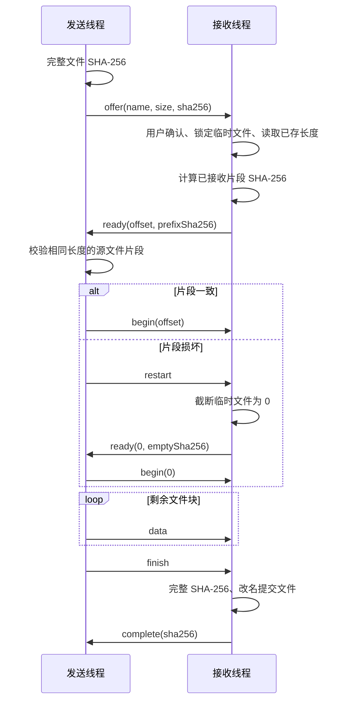

# ByteMe 技术设计

## 线程与 socket 的归属

主线程运行 Qt Widgets、UDP 发现、TCP 监听和任务调度。`QTcpServer::incomingConnection()` 只交出 `qintptr` 原生描述符，接收 worker 在线程启动后创建自己的 `QTcpSocket` 并调用 `setSocketDescriptor()`。

每个任务一个 `TransferWorker`，通过 `moveToThread()` 放入独立 `QThread`；socket 和定时器在 worker 的 `start()` 中创建。主界面通过 queued signal 更新，暂停与接收确认通过 queued invocation 进入 worker。文件哈希每次读取 256 KiB 并让出事件循环；发送每次最多处理 8 个 64 KiB 块，待写缓冲达到 512 KiB 时停止生产。

线程退出流程是：worker 关闭文件与 socket → 发出 `finished` → `deleteLater` 销毁 worker → 使用 direct connection 调用线程安全的 `QThread::quit` → 线程结束后释放线程对象。关闭窗口时先请求所有 worker 停止，再等待线程结束，避免仍运行的 `QThread` 被销毁。

Qt 的官方参考说明 socket 应在其所属线程使用，并提供通过 socket 描述符进行跨线程接收的方式：[QTcpServer](https://doc.qt.io/qt-6/qtcpserver.html)、[QAbstractSocket](https://doc.qt.io/qt-6/qabstractsocket.html)。UDP 使用方式见 [QUdpSocket](https://doc.qt.io/qt-6/qudpsocket.html)。

## 设备发现

UDP 消息是最大 2048 字节的 JSON，包含 `app=ByteMe`、`version=1`、设备 ID、显示名称、TCP 端口和类型：

- `hello`：启动、手动刷新、每 3 秒向广播地址发送。
- `alive`：收到 hello 后，向数据报实际来源地址和端口单播回复。
- `bye`：正常退出时广播离线信息。

广播发送到 `255.255.255.255` 及活动网卡的 IPv4 子网广播地址，接收使用 `AnyIPv4` 和共享绑定。设备 IP 来自 UDP 数据报实际来源，不采用消息内自行声明的地址。超过 12 秒没有心跳的设备移除；列表上限 256 台，每次处理最多 64 个数据报。

## TCP 帧格式

| 偏移 | 长度 | 内容 |
| --- | --- | --- |
| 0 | 4 字节 | 大端 uint32，后续帧体长度 |
| 4 | 1 字节 | 类型：1 = JSON 控制消息，2 = 原始文件数据 |
| 5 | 长度 - 1 | 消息负载 |

帧体长度必须在 1～256 KiB 内，控制负载不超过 8192 字节，数据负载不超过 64 KiB。读取缓冲、socket 缓冲与每次解析帧数有上限；不完整帧留待下次继续解析。文件大小和偏移使用十进制字符串，避免 JSON 浮点数精度问题。

双方在线时每 5 秒发送 `ping`。120 秒没有收到任何数据时结束连接并保留部分文件；ping 也算在线数据，因此用户接收确认可等待。发送端只有收到校验成功 ACK 才报告完成；100% 进度表示所有字节已排入发送缓冲或写入临时文件，校验阶段单独显示。

## 断点数据与完整性

临时文件标识是 `SHA256(UTF8文件名 + NUL + 大小 + NUL + 完整SHA256)`。接收目录内 `.byteme-partials/<id>.part` 保存数据，`<id>.json` 保存版本、原文件名、大小和摘要；`QSaveFile` 原子写入元数据。每文件 `QLockFile` 阻止同一个文件同时写入，接收目录的 `commit.lock` 串行保护不同内容的同名文件提交。断开后关闭文件，续传长度以磁盘上真实文件长度为准。

继续时发送端重新计算完整摘要。源文件若改变，内容标识改变，会建立新的临时文件。双方核对续传片段摘要，损坏片段从零重传。完成时接收端重新计算完整 SHA-256，再通过 `QFile::rename` 保存；原文件存在时递增名称，避免覆盖。名称不允许路径分隔符、控制字符、Windows 保留名、尾随点或空格；临时文件路径仅使用摘要，并拒绝链接形式的临时路径。

如最终 ACK 在网络中丢失，发送方会保留未完成状态，而接收方可能已有完整文件；再次发送可能产生同名副本。本版不实现跨连接的完成回执缓存或 exactly-once 交付。

## 后续可扩展方向

认证和 TLS、目录递归、任务历史数据库、传输限速、IPv6 与 mDNS、自动重连、飞鸽协议适配。当前“多线程传输”指多个文件任务并行；单个文件按顺序流式传输，并非多个连接分段下载同一文件。
